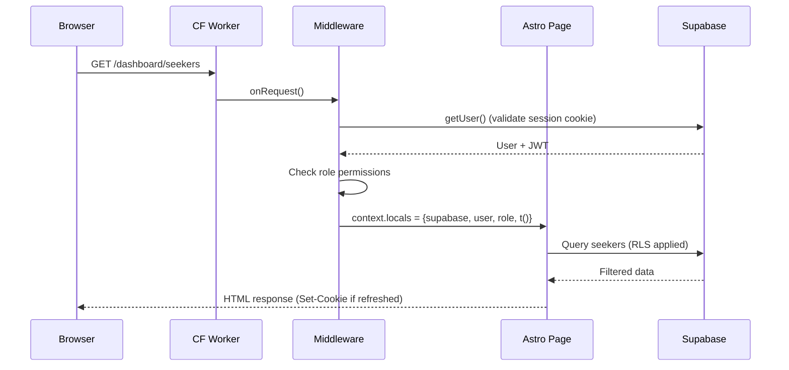
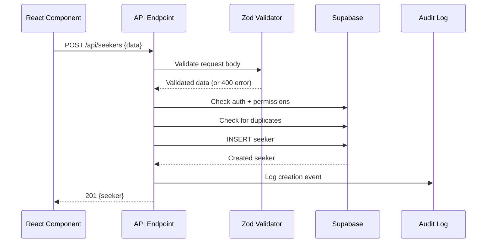
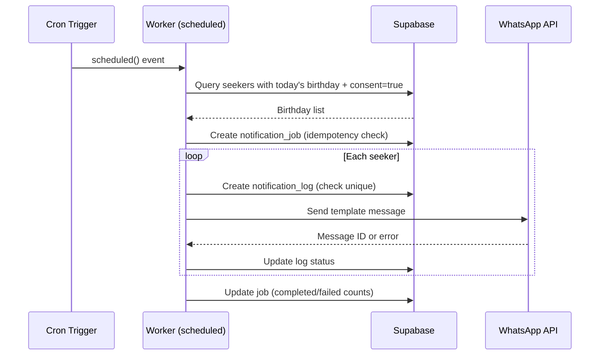
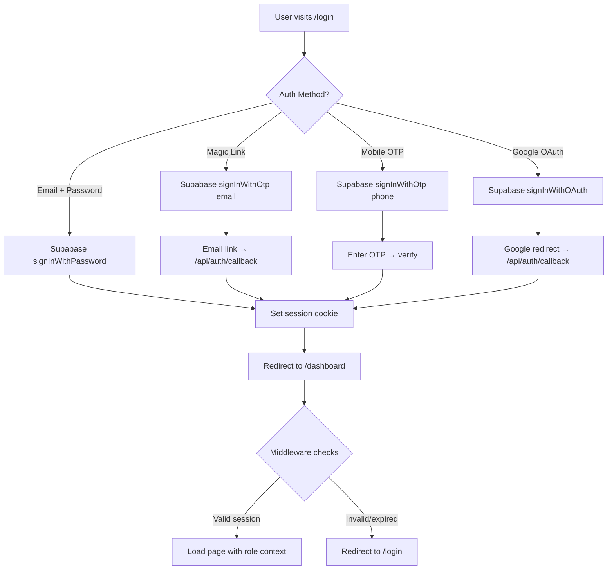
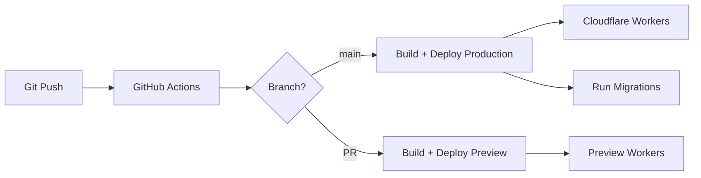

# System Architecture
## Bhuj Himalayan Samarpan Meditation Center Management System

**Version**: 1.0  
**Date**: October 2026  

---

## 1. Architecture Overview

### 1.1 High-Level Architecture

The system follows a **server-rendered web application** pattern using Astro.js as the primary framework with React islands for interactive components. All business logic executes server-side on Cloudflare Workers, with Supabase providing authentication, database, and storage services.

```
┌─────────────────────────────────────────────────────────────────┐
│                        Client Layer                              │
│  ┌──────────────┐  ┌──────────────┐  ┌──────────────────────┐   │
│  │ Public Pages  │  │  Dashboard   │  │  Mobile Browser      │   │
│  │ (SSR/Static)  │  │  (SSR+React) │  │  (Responsive)        │   │
│  └──────┬───────┘  └──────┬───────┘  └──────────┬───────────┘   │
└─────────┼──────────────────┼────────────────────┼───────────────┘
          │                  │                    │
          ▼                  ▼                    ▼
┌─────────────────────────────────────────────────────────────────┐
│                    Cloudflare Workers                             │
│  ┌──────────────────────────────────────────────────────────┐   │
│  │  Custom Worker Entry (src/worker.ts)                      │   │
│  │  ┌─────────┐  ┌───────────────┐  ┌────────────────────┐  │   │
│  │  │ fetch() │  │ scheduled()   │  │ Environment Vars   │  │   │
│  │  │ handler │  │ Cron Triggers │  │ & Secrets          │  │   │
│  │  └────┬────┘  └───────┬───────┘  └────────────────────┘  │   │
│  └───────┼───────────────┼──────────────────────────────────┘   │
│          ▼               ▼                                       │
│  ┌──────────────────────────────────────────────────────────┐   │
│  │  Astro SSR (@astrojs/cloudflare)                          │   │
│  │  ┌────────────┐  ┌──────────┐  ┌───────────────────┐     │   │
│  │  │ Middleware  │  │  Pages   │  │  API Endpoints    │     │   │
│  │  │ (Auth/i18n) │  │  (SSR)   │  │  (/api/*)         │     │   │
│  │  └────────────┘  └──────────┘  └───────────────────┘     │   │
│  └──────────────────────────────────────────────────────────┘   │
└─────────────────────────────────────────────────────────────────┘
          │                                    │
          ▼                                    ▼
┌─────────────────────────────┐  ┌────────────────────────────────┐
│        Supabase              │  │        External APIs            │
│  ┌───────────┐               │  │  ┌──────────────────────────┐  │
│  │ Auth      │               │  │  │ WhatsApp Cloud API       │  │
│  │ (JWT/SSR) │               │  │  │ (Meta Graph API v22.0)   │  │
│  ├───────────┤               │  │  └──────────────────────────┘  │
│  │ PostgreSQL│               │  │  ┌──────────────────────────┐  │
│  │ (RLS)     │               │  │  │ Twilio (SMS for OTP)     │  │
│  ├───────────┤               │  │  └──────────────────────────┘  │
│  │ Storage   │               │  └────────────────────────────────┘
│  │ (Private) │               │
│  └───────────┘               │
└─────────────────────────────┘
```

### 1.2 Key Architecture Decisions

| Decision | Choice | Rationale |
|----------|--------|-----------|
| **Rendering Strategy** | Server-Side Rendering (SSR) | Data freshness, SEO for public pages, server-side auth enforcement |
| **Client Interactivity** | React Islands via `client:load` | Only hydrate components that need JavaScript (forms, tables, charts) |
| **Database Access** | Supabase JS Client (HTTP/PostgREST) | Works on Cloudflare Workers (no TCP sockets needed) |
| **Auth Strategy** | Cookie-based sessions via `@supabase/ssr` | Secure, httpOnly cookies; automatic token refresh |
| **Background Jobs** | Cloudflare Cron Triggers | Reliable, no extra infrastructure; runs independent of user visits |
| **File Storage** | Supabase Storage (private buckets) | Integrated with auth; signed URLs for secure access |
| **WhatsApp Integration** | Direct `fetch()` to Meta Graph API | Workers-compatible; no heavy SDK needed |
| **i18n** | Custom JSON-based with typed keys | Lightweight; works in both Astro and React contexts |
| **Validation** | Zod schemas | TypeScript-first; works server and client side |
| **CSS Framework** | Tailwind CSS v4 (Vite plugin) | CSS-first config; excellent DX with Astro |

---

## 2. Request Flow

### 2.1 Authenticated Page Request



### 2.2 API Request (e.g., Create Seeker)



### 2.3 Cron Trigger (Birthday Greetings)



---

## 3. Security Architecture

### 3.1 Authentication Flow



### 3.2 Authorization Layers

```
Layer 1: Middleware (src/middleware.ts)
├── Validates session cookie
├── Populates user, role, permissions in Astro.locals
└── Redirects unauthenticated users

Layer 2: Page/API Route Guards
├── Check specific permissions before data access
├── Validate center-scoped access
└── Return 403 for unauthorized actions

Layer 3: Supabase RLS (Database Level)
├── SECURITY DEFINER helper functions
├── Row-level filtering based on user's JWT claims
└── Center-scoped policies using user_roles table

Layer 4: Database Constraints
├── CHECK constraints for valid values
├── UNIQUE constraints for duplicates
├── Foreign key integrity
└── NOT NULL for required fields
```

### 3.3 Secret Management

| Secret | Storage | Access |
|--------|---------|--------|
| `SUPABASE_ANON_KEY` | Wrangler vars (public) | Client + Server |
| `SUPABASE_SERVICE_ROLE_KEY` | Wrangler secrets | Server only |
| `WHATSAPP_ACCESS_TOKEN` | Wrangler secrets | Server only |
| `WHATSAPP_PHONE_NUMBER_ID` | Wrangler secrets | Server only |
| Google OAuth credentials | Supabase dashboard | Supabase Auth service |
| Twilio credentials | Supabase dashboard | Supabase Auth service |

---

## 4. Data Architecture

### 4.1 Supabase Client Strategy

```typescript
// Server-side client (per-request, cookie-based)
// Used in Astro pages, API routes, middleware
const supabase = createServerClient(url, anonKey, {
  cookies: { getAll, setAll }
});

// Admin client (service role, bypasses RLS)
// Used ONLY for system operations: cron jobs, admin-only operations
const adminClient = createClient(url, serviceRoleKey);
```

### 4.2 RLS Strategy

All tables have RLS enabled. Access is controlled via `SECURITY DEFINER` helper functions for performance:

```sql
-- Helper: Check if current user has a specific role
CREATE FUNCTION auth.user_has_role(allowed_roles text[])
RETURNS boolean AS $$
  SELECT EXISTS (
    SELECT 1 FROM user_roles ur
    JOIN roles r ON ur.role_id = r.id
    WHERE ur.user_id = auth.uid()
      AND r.name = ANY(allowed_roles)
      AND ur.is_active = true
  );
$$ LANGUAGE sql SECURITY DEFINER SET search_path = '';

-- Helper: Get center IDs the current user is assigned to
CREATE FUNCTION auth.user_center_ids()
RETURNS uuid[] AS $$
  SELECT COALESCE(
    array_agg(ur.center_id),
    '{}'::uuid[]
  )
  FROM user_roles ur
  WHERE ur.user_id = auth.uid()
    AND ur.center_id IS NOT NULL
    AND ur.is_active = true;
$$ LANGUAGE sql SECURITY DEFINER SET search_path = '';
```

### 4.3 Shared Inventory Model

Products, seasonal fruits, and Sahitya share a common inventory architecture:

```
products (category: seasonal_fruit | dhyansthali_product | granth | sahitya)
  └── product_variants (size, weight, edition variants)
       └── inventory_movements (stock_in, stock_out, adjustment)
       └── order_items
            └── orders (per-seeker, per-category)
                 └── payments
```

This eliminates data duplication while allowing module-specific views through category filtering.

---

## 5. Deployment Architecture

### 5.1 Environments

| Environment | URL | Purpose |
|-------------|-----|---------|
| Local Dev | `http://localhost:4321` | Development with Supabase local |
| Preview | `*.bhuj-meditation.workers.dev` | PR previews |
| Production | Custom domain (TBD) | Live application |

### 5.2 CI/CD Pipeline



### 5.3 Cloudflare Workers Configuration

```jsonc
{
  "name": "bhuj-meditation-center",
  "compatibility_date": "2026-10-13",
  "triggers": {
    "crons": [
      "0 1 * * *",     // Daily birthday/anniversary greetings (01:00 UTC = 06:30 IST)
      "0 */6 * * *"    // Event reminders + retry failed messages
    ]
  }
}
```

---

## 6. i18n Architecture

### 6.1 Translation System

```typescript
// src/i18n/index.ts
type Locale = 'en' | 'gu';

// Translations are typed — missing keys cause compile errors
const translations: Record<Locale, TranslationStrings> = {
  en: { /* ... */ },
  gu: { /* ... */ }
};

// Astro pages: t('key') via Astro.locals.t
// React components: useTranslation() hook reads locale from context
```

### 6.2 Locale Detection Priority

1. User preference cookie (`locale=gu`)
2. User profile `preferred_language` (for logged-in users)
3. `Accept-Language` header
4. Default: `en`

### 6.3 Bilingual Data Strategy

User-generated content (center names, event titles) is stored with dual columns:
- `name_en` — English (required)
- `name_gu` — Gujarati (optional, falls back to English)

UI strings use the translation file system; data displays based on current locale with English fallback.

---

## 7. Error Handling

### 7.1 Strategy

```
Client Error (4xx) → User-friendly message + form highlight
Server Error (5xx) → Generic error page + server-side logging
Supabase Error     → Mapped to appropriate HTTP status
WhatsApp API Error → Queued for retry + logged
Network Error      → Retry with exponential backoff (background jobs)
```

### 7.2 Error Boundaries

- **Astro pages**: Try-catch in frontmatter → render error state
- **React islands**: React Error Boundaries → fallback UI
- **API routes**: Centralized error handler → JSON error response
- **Cron jobs**: Try-catch per operation → continue processing, log failures

---

## 8. Monitoring & Observability

| Aspect | Tool | Notes |
|--------|------|-------|
| Application errors | `console.error` + Cloudflare Logs | Workers Logs Tail |
| Request metrics | Cloudflare Analytics | Built-in Workers analytics |
| Cron execution | `notification_jobs` table | Status, counts, errors |
| Auth events | Supabase Auth logs | Sign-in, sign-out, failures |
| Database performance | Supabase Dashboard | Query performance, connections |
