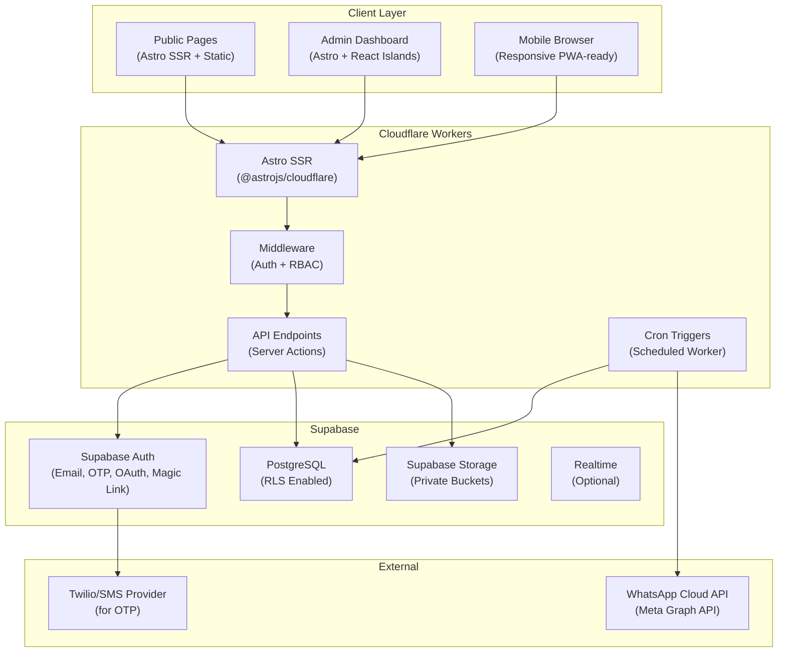
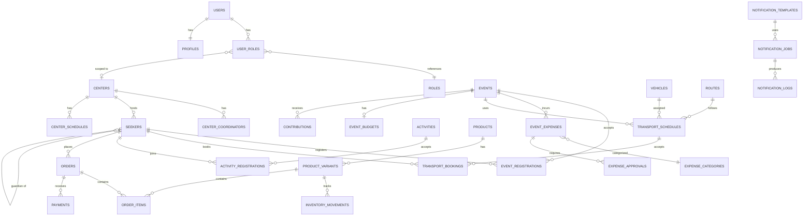

# Bhuj Himalayan Samarpan Meditation Center — Master Implementation Plan

## Goal Description

Build a **production-ready, bilingual (English + Gujarati) web application** for managing seekers, meditation centers, events, transportation, activities, products, spiritual literature, and finances — deployed on Cloudflare Workers with Supabase as the backend.

The system serves **500–1000+ seekers across multiple active meditation centers** in Bhuj, Gujarat, managed by volunteer coordinators with role-based access.

> [!IMPORTANT]
> This plan covers all 8 phases of the SDLC. Each phase must pass its acceptance criteria before the next begins. **Phase 0 deliverables (this document + docs/) are the immediate output.**

---

## User Review Required

> [!IMPORTANT]
> **Design Theme Confirmation**: The UI will use a **modern minimal** approach — clean whites, soft warm gradients (#FFF8F0 → #FFF), subtle accent colors (saffron amber `#E8973A`, Himalayan blue `#4A90D9`, sage green `#6B9F78`), with Inter/Noto Sans Gujarati typography. Public pages get a serene, meditation-inspired aesthetic; admin dashboards get a clean professional feel.

> [!IMPORTANT]
> **Bilingual from Phase 1**: Full English + Gujarati i18n infrastructure in the foundation. All UI strings go through a centralized translation system using JSON locale files (`en.json`, `gu.json`). Astro pages and React components both consume the same translation utility.

> [!WARNING]
> **Authentication**: Supporting all 4 methods (Email+Password, Mobile OTP, Magic Link, Google OAuth). Note that **Mobile OTP requires a Twilio or compatible SMS provider** configured in Supabase. This will be documented but the actual SMS provider setup is your responsibility.

> [!CAUTION]
> **WhatsApp Business API**: Requires a **Meta Business Account**, **verified business**, and **approved message templates** before sending production messages. Phase 3 will build the integration architecture and queue system, but you must complete the Meta business verification process separately. Setup guidance is included.

---

## Open Questions

> [!IMPORTANT]
> **Q1 — Custom Domain**: Do you already have a domain name for this application (e.g., `bhujdhyan.org`)? If not, should I include domain registration guidance?

> [!IMPORTANT]
> **Q2 — Supabase Plan**: The free tier supports up to 500MB database, 1GB storage, 50,000 monthly active users. This should be sufficient initially. Should we plan for the free tier or Pro ($25/mo)?

> [!IMPORTANT]
> **Q3 — Receipt Storage**: For expense receipts and documents (Module L), should uploaded files be restricted to images only (JPG/PNG), or also PDFs? What maximum file size per upload?

---

## Architecture Overview



### Technology Stack Summary

| Layer | Technology | Version / Notes |
|-------|-----------|----------------|
| **Framework** | Astro | Latest stable (v5+) |
| **UI Islands** | React + TypeScript | For interactive components |
| **CSS** | Tailwind CSS v4 | Vite plugin, CSS-first config |
| **Database** | Supabase PostgreSQL | RLS-enabled, version-controlled migrations |
| **Auth** | Supabase Auth + `@supabase/ssr` | Cookie-based sessions on Workers |
| **Storage** | Supabase Storage | Private buckets for receipts |
| **Hosting** | Cloudflare Workers | `@astrojs/cloudflare` adapter |
| **Cron** | Cloudflare Cron Triggers | Custom worker entry point (`src/worker.ts`) |
| **WhatsApp** | Meta Graph API v22.0 | Direct HTTP `fetch()` calls (no axios — Workers compatible) |
| **i18n** | Custom JSON-based + Astro middleware | `en.json` / `gu.json` locale files |
| **Version Control** | Git + GitHub | Initialized from Phase 1 |

---

## Project Structure

```
bhuj-meditation-center/
├── .github/
│   └── workflows/
│       └── deploy.yml              # GitHub Actions → Cloudflare deploy
├── docs/
│   ├── PRD.md                      # Product Requirements Document
│   ├── ARCHITECTURE.md             # System architecture
│   ├── ROLE_PERMISSIONS.md         # Role-permission matrix
│   ├── DATABASE_SCHEMA.md          # Database design
│   ├── IMPLEMENTATION_PLAN.md      # This plan (refined)
│   ├── WHATSAPP_SETUP.md           # WhatsApp Business API setup guide
│   ├── CLOUDFLARE_SETUP.md         # Cloudflare account & deployment guide
│   └── SUPABASE_SETUP.md           # Supabase project setup guide
├── public/
│   ├── favicon.svg
│   ├── images/                     # Static images
│   └── locales/
│       ├── en.json                 # English translations
│       └── gu.json                 # Gujarati translations
├── src/
│   ├── components/
│   │   ├── astro/                  # Shared Astro components
│   │   │   ├── Header.astro
│   │   │   ├── Footer.astro
│   │   │   ├── Sidebar.astro
│   │   │   ├── LanguageSwitcher.astro
│   │   │   └── Breadcrumb.astro
│   │   └── react/                  # Shared React components
│   │       ├── ui/                 # Base UI (Button, Input, Modal, Table, etc.)
│   │       ├── forms/              # Reusable form components
│   │       ├── charts/             # Chart/KPI components
│   │       └── DataTable.tsx       # Paginated, sortable data table
│   ├── features/
│   │   ├── auth/                   # Authentication pages & logic
│   │   │   ├── components/
│   │   │   ├── lib/
│   │   │   └── pages/
│   │   ├── dashboard/              # Role-specific dashboards
│   │   ├── seekers/                # Seeker management
│   │   │   ├── components/
│   │   │   ├── lib/
│   │   │   │   ├── queries.ts      # Supabase queries
│   │   │   │   ├── validations.ts  # Zod schemas
│   │   │   │   └── types.ts
│   │   │   └── pages/
│   │   ├── centers/                # Center management
│   │   ├── events/                 # Events & registrations
│   │   ├── notifications/          # WhatsApp automation
│   │   ├── transport/              # Dhyan Rath + Bus booking
│   │   ├── activities/             # Ratri Sadhna + community activities
│   │   ├── products/               # Seasonal fruits + Dhyansthali products
│   │   ├── sahitya/                # Granth & spiritual literature
│   │   ├── finance/                # Budgets, expenses, transparency
│   │   └── analytics/              # Reports & dashboards
│   ├── i18n/
│   │   ├── index.ts                # Translation utility
│   │   ├── en.ts                   # English strings (typed)
│   │   └── gu.ts                   # Gujarati strings (typed)
│   ├── layouts/
│   │   ├── BaseLayout.astro        # HTML shell + meta + global styles
│   │   ├── PublicLayout.astro      # Public pages layout
│   │   ├── DashboardLayout.astro   # Authenticated dashboard layout
│   │   └── AuthLayout.astro        # Login/register layout
│   ├── lib/
│   │   ├── supabase/
│   │   │   ├── client.ts           # Server-side Supabase client factory
│   │   │   ├── admin.ts            # Service-role client (server only)
│   │   │   └── types.ts            # Generated DB types
│   │   ├── auth/
│   │   │   ├── permissions.ts      # Permission checking utilities
│   │   │   └── roles.ts            # Role constants & hierarchy
│   │   ├── whatsapp/
│   │   │   ├── client.ts           # WhatsApp API client
│   │   │   ├── templates.ts        # Template definitions
│   │   │   └── queue.ts            # Message queue handler
│   │   └── utils/
│   │       ├── validation.ts       # Shared Zod schemas
│   │       ├── formatting.ts       # Date, currency, number formatters
│   │       └── errors.ts           # Error handling utilities
│   ├── middleware.ts               # Auth + locale + RBAC middleware
│   ├── pages/
│   │   ├── index.astro             # Public homepage
│   │   ├── about.astro             # About meditation
│   │   ├── centers.astro           # Public center listing
│   │   ├── events.astro            # Public event listing
│   │   ├── login.astro             # Login page
│   │   ├── register.astro          # Registration page
│   │   ├── api/
│   │   │   ├── auth/
│   │   │   │   ├── callback.ts     # OAuth/magic link callback
│   │   │   │   ├── login.ts        # Login handler
│   │   │   │   ├── logout.ts       # Logout handler
│   │   │   │   └── register.ts     # Registration handler
│   │   │   ├── seekers/            # Seeker CRUD API
│   │   │   ├── centers/            # Center CRUD API
│   │   │   ├── events/             # Event CRUD API
│   │   │   ├── transport/          # Booking API
│   │   │   ├── products/           # Products API
│   │   │   ├── finance/            # Finance API
│   │   │   └── notifications/      # WhatsApp API
│   │   └── dashboard/
│   │       ├── index.astro         # Dashboard home (role-routed)
│   │       ├── seekers/            # Seeker management pages
│   │       ├── centers/            # Center management pages
│   │       ├── events/             # Event management pages
│   │       ├── transport/          # Transport management pages
│   │       ├── activities/         # Activities management pages
│   │       ├── products/           # Products management pages
│   │       ├── sahitya/            # Sahitya management pages
│   │       ├── finance/            # Finance management pages
│   │       ├── analytics/          # Analytics pages
│   │       ├── notifications/      # Notification management pages
│   │       └── settings/           # System settings (Super Admin)
│   ├── styles/
│   │   └── global.css              # Tailwind v4 imports + design tokens
│   ├── worker.ts                   # Custom CF Worker entry (fetch + scheduled)
│   └── env.d.ts                    # TypeScript environment declarations
├── supabase/
│   ├── migrations/
│   │   ├── 00001_auth_and_roles.sql
│   │   ├── 00002_centers.sql
│   │   ├── 00003_seekers.sql
│   │   ├── 00004_events.sql
│   │   ├── 00005_notifications.sql
│   │   ├── 00006_transport.sql
│   │   ├── 00007_activities.sql
│   │   ├── 00008_products_inventory.sql
│   │   ├── 00009_finance.sql
│   │   └── 00010_rls_policies.sql
│   ├── seed.sql                    # Development seed data
│   └── config.toml                 # Supabase CLI local config
├── tests/
│   ├── unit/
│   ├── integration/
│   └── e2e/
├── astro.config.mjs
├── tailwind.config.ts              # (if needed for v4 customization)
├── tsconfig.json
├── package.json
├── wrangler.jsonc
├── .env.example                    # Environment variable template
├── .gitignore
└── README.md
```

---

## Role-Permission Matrix

### Roles

| # | Role | Scope | Description |
|---|------|-------|-------------|
| 1 | **Super Admin** | Global | IT team. Full system access, user management, system settings |
| 2 | **Admin** | Global | Center leadership. Manages all modules, users, financial approvals |
| 3 | **Center Coordinator** | Center-scoped | Manages their assigned center's seekers, events, activities |
| 4 | **Event Coordinator** | Module-scoped | Manages events, registrations, attendance across centers |
| 5 | **Ratri Sadhna Coordinator** | Module-scoped | Manages Ratri Sadhna scheduling, registrations, attendance |
| 6 | **Bus Coordinator** | Module-scoped | Manages bus bookings, routes, capacity for events |
| 7 | **Dhyan Rath Coordinator** | Module-scoped | Manages Dhyan Rath vehicles, schedules, bookings |
| 8 | **Product Coordinator** | Module-scoped | Manages seasonal fruits, products, orders, inventory |
| 9 | **Sahitya Coordinator** | Module-scoped | Manages Granths, spiritual literature, distribution |

### Permission Matrix

| Module / Action | Super Admin | Admin | Center Coord | Event Coord | Ratri Sadhna Coord | Bus Coord | Dhyan Rath Coord | Product Coord | Sahitya Coord |
|----------------|:-----------:|:-----:|:------------:|:-----------:|:------------------:|:---------:|:----------------:|:-------------:|:-------------:|
| **System Settings** | CRUD | R | — | — | — | — | — | — | — |
| **User Management** | CRUD | CRU | — | — | — | — | — | — | — |
| **Audit Logs** | R | R | — | — | — | — | — | — | — |
| **Seekers — Read** | ✅ | ✅ | Own center | ✅ | ✅ | ✅ | ✅ | ✅ | ✅ |
| **Seekers — Create/Update** | ✅ | ✅ | Own center | — | — | — | — | — | — |
| **Seekers — Delete (Soft)** | ✅ | ✅ | — | — | — | — | — | — | — |
| **Seekers — Export** | ✅ | ✅ | Own center | — | — | — | — | — | — |
| **Seekers — Import** | ✅ | ✅ | — | — | — | — | — | — | — |
| **Centers — CRUD** | ✅ | ✅ | R own | R | R | R | R | R | R |
| **Events — CRUD** | ✅ | ✅ | Own center | ✅ | — | — | — | — | — |
| **Event Registration** | ✅ | ✅ | Own center | ✅ | — | — | — | — | — |
| **Event Attendance** | ✅ | ✅ | Own center | ✅ | — | — | — | — | — |
| **WhatsApp — Templates** | ✅ | ✅ | — | — | — | — | — | — | — |
| **WhatsApp — Send/Queue** | ✅ | ✅ | Own center | ✅ | ✅ | ✅ | ✅ | — | — |
| **WhatsApp — Logs** | ✅ | ✅ | Own center | R | R | R | R | — | — |
| **Dhyan Rath — Vehicles** | ✅ | ✅ | — | — | — | — | ✅ | — | — |
| **Dhyan Rath — Bookings** | ✅ | ✅ | R | — | — | — | ✅ | — | — |
| **Bus — Routes/Buses** | ✅ | ✅ | — | — | — | ✅ | — | — | — |
| **Bus — Bookings** | ✅ | ✅ | R | ✅ | — | ✅ | — | — | — |
| **Ratri Sadhna** | ✅ | ✅ | R own | — | ✅ | — | — | — | — |
| **Activities** | ✅ | ✅ | R own | — | ✅ | — | — | — | — |
| **Products — Catalog** | ✅ | ✅ | R | — | — | — | — | ✅ | — |
| **Products — Orders** | ✅ | ✅ | R own | — | — | — | — | ✅ | — |
| **Products — Inventory** | ✅ | ✅ | — | — | — | — | — | ✅ | — |
| **Sahitya — Catalog** | ✅ | ✅ | R | — | — | — | — | — | ✅ |
| **Sahitya — Orders** | ✅ | ✅ | R own | — | — | — | — | — | ✅ |
| **Sahitya — Inventory** | ✅ | ✅ | — | — | — | — | — | — | ✅ |
| **Finance — View** | ✅ | ✅ | Own center | ✅ | — | — | — | — | — |
| **Finance — Create/Edit** | ✅ | ✅ | — | ✅ | — | — | — | — | — |
| **Finance — Approve** | ✅ | ✅ | — | — | — | — | — | — | — |
| **Finance — Public Summary** | ✅ | ✅ | — | — | — | — | — | — | — |
| **Analytics — All** | ✅ | ✅ | Own center | Own module | Own module | Own module | Own module | Own module | Own module |

**Legend**: ✅ = Full access | CRUD = Create/Read/Update/Delete | CRU = Create/Read/Update | R = Read only | "Own center" = scoped to assigned center(s) | "Own module" = scoped to their managed module | — = No access

---

## Database Schema Design

### Entity Relationship Diagram



### Core Tables

#### Authentication & Authorization

```sql
-- Extends Supabase auth.users
CREATE TABLE profiles (
    id UUID PRIMARY KEY REFERENCES auth.users(id) ON DELETE CASCADE,
    full_name TEXT NOT NULL,
    display_name TEXT,
    phone TEXT,
    avatar_url TEXT,
    preferred_language TEXT DEFAULT 'en' CHECK (preferred_language IN ('en', 'gu')),
    is_active BOOLEAN DEFAULT true,
    created_at TIMESTAMPTZ DEFAULT now(),
    updated_at TIMESTAMPTZ DEFAULT now()
);

CREATE TABLE roles (
    id SERIAL PRIMARY KEY,
    name TEXT UNIQUE NOT NULL,  -- 'super_admin', 'admin', 'center_coordinator', etc.
    display_name_en TEXT NOT NULL,
    display_name_gu TEXT NOT NULL,
    description TEXT,
    hierarchy_level INT NOT NULL, -- 1=highest (super_admin), 9=lowest
    created_at TIMESTAMPTZ DEFAULT now()
);

CREATE TABLE user_roles (
    id UUID PRIMARY KEY DEFAULT gen_random_uuid(),
    user_id UUID NOT NULL REFERENCES auth.users(id) ON DELETE CASCADE,
    role_id INT NOT NULL REFERENCES roles(id),
    center_id UUID REFERENCES centers(id), -- NULL for global roles
    assigned_by UUID REFERENCES auth.users(id),
    is_active BOOLEAN DEFAULT true,
    created_at TIMESTAMPTZ DEFAULT now(),
    updated_at TIMESTAMPTZ DEFAULT now(),
    UNIQUE(user_id, role_id, center_id)
);

CREATE TABLE permissions (
    id SERIAL PRIMARY KEY,
    module TEXT NOT NULL,  -- 'seekers', 'events', 'transport', etc.
    action TEXT NOT NULL,  -- 'read', 'create', 'update', 'delete', 'approve', 'export', 'manage'
    description TEXT,
    UNIQUE(module, action)
);

CREATE TABLE role_permissions (
    role_id INT REFERENCES roles(id) ON DELETE CASCADE,
    permission_id INT REFERENCES permissions(id) ON DELETE CASCADE,
    scope TEXT DEFAULT 'global' CHECK (scope IN ('global', 'center', 'own')),
    PRIMARY KEY (role_id, permission_id)
);

-- Audit log for administrative changes
CREATE TABLE audit_logs (
    id UUID PRIMARY KEY DEFAULT gen_random_uuid(),
    user_id UUID REFERENCES auth.users(id),
    action TEXT NOT NULL,       -- 'create', 'update', 'delete', 'login', 'approve'
    entity_type TEXT NOT NULL,  -- 'seeker', 'event', 'expense', etc.
    entity_id UUID,
    old_values JSONB,
    new_values JSONB,
    ip_address TEXT,
    user_agent TEXT,
    created_at TIMESTAMPTZ DEFAULT now()
);
```

#### Centers

```sql
CREATE TABLE centers (
    id UUID PRIMARY KEY DEFAULT gen_random_uuid(),
    name_en TEXT NOT NULL,
    name_gu TEXT NOT NULL,
    contact_number TEXT,
    email TEXT,
    address_en TEXT,
    address_gu TEXT,
    city TEXT DEFAULT 'Bhuj',
    state TEXT DEFAULT 'Gujarat',
    pincode TEXT,
    latitude DECIMAL(10, 8),
    longitude DECIMAL(11, 8),
    shanchalak_name TEXT,
    shanchalak_contact TEXT,
    meditation_days TEXT[],      -- ['monday', 'wednesday', 'friday']
    session_timings JSONB,      -- [{"day": "monday", "start": "06:00", "end": "07:00"}]
    instructions_en TEXT,
    instructions_gu TEXT,
    is_active BOOLEAN DEFAULT true,
    created_at TIMESTAMPTZ DEFAULT now(),
    updated_at TIMESTAMPTZ DEFAULT now()
);

CREATE TABLE center_coordinators (
    center_id UUID REFERENCES centers(id) ON DELETE CASCADE,
    user_id UUID REFERENCES auth.users(id) ON DELETE CASCADE,
    role TEXT DEFAULT 'coordinator',
    assigned_at TIMESTAMPTZ DEFAULT now(),
    PRIMARY KEY (center_id, user_id)
);
```

#### Seekers

```sql
CREATE TABLE seekers (
    id UUID PRIMARY KEY DEFAULT gen_random_uuid(),
    seeker_id TEXT UNIQUE NOT NULL, -- Human-readable: BHJ-0001, BHJ-0002
    first_name_en TEXT NOT NULL,
    last_name_en TEXT NOT NULL,
    first_name_gu TEXT,
    last_name_gu TEXT,
    mobile TEXT,
    email TEXT,
    date_of_birth DATE,
    anniversary_date DATE,
    gender TEXT CHECK (gender IN ('male', 'female', 'other')),
    address_en TEXT,
    address_gu TEXT,
    city TEXT DEFAULT 'Bhuj',
    pincode TEXT,
    center_id UUID REFERENCES centers(id),
    guardian_id UUID REFERENCES seekers(id),    -- For minors
    guardian_relation TEXT,
    guardian_consent BOOLEAN DEFAULT false,
    is_minor BOOLEAN DEFAULT false,
    notification_consent BOOLEAN DEFAULT true,  -- WhatsApp opt-in
    notification_preferences JSONB DEFAULT '{"birthday": true, "anniversary": true, "events": true, "general": true}',
    status TEXT DEFAULT 'active' CHECK (status IN ('active', 'inactive', 'archived')),
    registration_date DATE DEFAULT CURRENT_DATE,
    notes TEXT,
    created_by UUID REFERENCES auth.users(id),
    created_at TIMESTAMPTZ DEFAULT now(),
    updated_at TIMESTAMPTZ DEFAULT now()
);

-- Duplicate detection index
CREATE INDEX idx_seekers_mobile ON seekers(mobile) WHERE mobile IS NOT NULL;
CREATE INDEX idx_seekers_name ON seekers(lower(first_name_en), lower(last_name_en));
CREATE INDEX idx_seekers_center ON seekers(center_id);
CREATE INDEX idx_seekers_status ON seekers(status);
```

#### Events

```sql
CREATE TYPE event_type AS ENUM ('local', 'outstation', 'meditation_program', 'special', 'other');
CREATE TYPE event_status AS ENUM ('draft', 'published', 'registration_open', 'registration_closed', 'ongoing', 'completed', 'cancelled');

CREATE TABLE events (
    id UUID PRIMARY KEY DEFAULT gen_random_uuid(),
    title_en TEXT NOT NULL,
    title_gu TEXT,
    description_en TEXT,
    description_gu TEXT,
    event_type event_type NOT NULL,
    status event_status DEFAULT 'draft',
    venue_en TEXT,
    venue_gu TEXT,
    venue_address TEXT,
    center_id UUID REFERENCES centers(id),      -- NULL for cross-center events
    start_date TIMESTAMPTZ NOT NULL,
    end_date TIMESTAMPTZ NOT NULL,
    registration_start TIMESTAMPTZ,
    registration_end TIMESTAMPTZ,
    max_capacity INT,
    requires_transport BOOLEAN DEFAULT false,
    is_public BOOLEAN DEFAULT false,            -- Show on public pages
    created_by UUID REFERENCES auth.users(id),
    created_at TIMESTAMPTZ DEFAULT now(),
    updated_at TIMESTAMPTZ DEFAULT now()
);

CREATE TYPE registration_status AS ENUM ('registered', 'waitlisted', 'cancelled', 'attended', 'no_show');

CREATE TABLE event_registrations (
    id UUID PRIMARY KEY DEFAULT gen_random_uuid(),
    event_id UUID NOT NULL REFERENCES events(id) ON DELETE CASCADE,
    seeker_id UUID NOT NULL REFERENCES seekers(id),
    status registration_status DEFAULT 'registered',
    registered_at TIMESTAMPTZ DEFAULT now(),
    cancelled_at TIMESTAMPTZ,
    attended_at TIMESTAMPTZ,
    waitlist_position INT,
    notes TEXT,
    registered_by UUID REFERENCES auth.users(id),
    UNIQUE(event_id, seeker_id)
);
```

#### Transport (Shared for Dhyan Rath & Bus)

```sql
CREATE TYPE vehicle_type AS ENUM ('dhyan_rath', 'bus', 'other');

CREATE TABLE vehicles (
    id UUID PRIMARY KEY DEFAULT gen_random_uuid(),
    name TEXT NOT NULL,
    vehicle_type vehicle_type NOT NULL,
    registration_number TEXT,
    seat_capacity INT NOT NULL,
    driver_name TEXT,
    driver_contact TEXT,
    is_active BOOLEAN DEFAULT true,
    created_at TIMESTAMPTZ DEFAULT now(),
    updated_at TIMESTAMPTZ DEFAULT now()
);

CREATE TABLE routes (
    id UUID PRIMARY KEY DEFAULT gen_random_uuid(),
    name_en TEXT NOT NULL,
    name_gu TEXT,
    origin TEXT NOT NULL,
    destination TEXT NOT NULL,
    pickup_points JSONB,    -- [{"name": "Madam Rd", "time": "06:00"}, ...]
    distance_km DECIMAL(8,2),
    estimated_duration_minutes INT,
    is_active BOOLEAN DEFAULT true,
    created_at TIMESTAMPTZ DEFAULT now()
);

CREATE TABLE transport_schedules (
    id UUID PRIMARY KEY DEFAULT gen_random_uuid(),
    vehicle_id UUID NOT NULL REFERENCES vehicles(id),
    route_id UUID NOT NULL REFERENCES routes(id),
    event_id UUID REFERENCES events(id),        -- NULL for regular Dhyan Rath trips
    departure_datetime TIMESTAMPTZ NOT NULL,
    return_datetime TIMESTAMPTZ,
    available_seats INT NOT NULL,
    booked_seats INT DEFAULT 0,
    booking_open BOOLEAN DEFAULT true,
    is_free BOOLEAN DEFAULT true,               -- Dhyan Rath is usually free
    fare_amount DECIMAL(10,2) DEFAULT 0,
    notes TEXT,
    created_by UUID REFERENCES auth.users(id),
    created_at TIMESTAMPTZ DEFAULT now(),
    updated_at TIMESTAMPTZ DEFAULT now(),
    CONSTRAINT seats_check CHECK (booked_seats <= available_seats)
);

CREATE TYPE booking_status AS ENUM ('confirmed', 'waitlisted', 'cancelled');

CREATE TABLE transport_bookings (
    id UUID PRIMARY KEY DEFAULT gen_random_uuid(),
    schedule_id UUID NOT NULL REFERENCES transport_schedules(id),
    seeker_id UUID NOT NULL REFERENCES seekers(id),
    pickup_point TEXT,
    status booking_status DEFAULT 'confirmed',
    waitlist_position INT,
    booked_at TIMESTAMPTZ DEFAULT now(),
    cancelled_at TIMESTAMPTZ,
    booked_by UUID REFERENCES auth.users(id),
    UNIQUE(schedule_id, seeker_id)
);
```

#### Activities (Ratri Sadhna + Community)

```sql
CREATE TYPE activity_type AS ENUM ('ratri_sadhna', 'sports', 'community', 'other');

CREATE TABLE activities (
    id UUID PRIMARY KEY DEFAULT gen_random_uuid(),
    title_en TEXT NOT NULL,
    title_gu TEXT,
    activity_type activity_type NOT NULL,
    description_en TEXT,
    description_gu TEXT,
    venue_en TEXT,
    venue_gu TEXT,
    center_id UUID REFERENCES centers(id),
    start_datetime TIMESTAMPTZ NOT NULL,
    end_datetime TIMESTAMPTZ,
    max_capacity INT,
    is_recurring BOOLEAN DEFAULT false,
    recurrence_rule TEXT,           -- iCal RRULE format
    created_by UUID REFERENCES auth.users(id),
    created_at TIMESTAMPTZ DEFAULT now(),
    updated_at TIMESTAMPTZ DEFAULT now()
);

CREATE TABLE activity_registrations (
    id UUID PRIMARY KEY DEFAULT gen_random_uuid(),
    activity_id UUID NOT NULL REFERENCES activities(id) ON DELETE CASCADE,
    seeker_id UUID NOT NULL REFERENCES seekers(id),
    status TEXT DEFAULT 'registered' CHECK (status IN ('registered', 'attended', 'cancelled')),
    registered_at TIMESTAMPTZ DEFAULT now(),
    attended_at TIMESTAMPTZ,
    registered_by UUID REFERENCES auth.users(id),
    UNIQUE(activity_id, seeker_id)
);
```

#### Products & Inventory (Shared across Fruits, Products, Sahitya)

```sql
CREATE TYPE product_category AS ENUM ('seasonal_fruit', 'dhyansthali_product', 'granth', 'sahitya', 'other');

CREATE TABLE products (
    id UUID PRIMARY KEY DEFAULT gen_random_uuid(),
    name_en TEXT NOT NULL,
    name_gu TEXT,
    category product_category NOT NULL,
    description_en TEXT,
    description_gu TEXT,
    is_active BOOLEAN DEFAULT true,
    created_at TIMESTAMPTZ DEFAULT now(),
    updated_at TIMESTAMPTZ DEFAULT now()
);

CREATE TABLE product_variants (
    id UUID PRIMARY KEY DEFAULT gen_random_uuid(),
    product_id UUID NOT NULL REFERENCES products(id) ON DELETE CASCADE,
    variant_name_en TEXT NOT NULL,   -- "1 dozen", "5 kg box", "Hardcover"
    variant_name_gu TEXT,
    sku TEXT UNIQUE,
    price DECIMAL(10,2) DEFAULT 0,
    unit TEXT,                       -- 'kg', 'dozen', 'piece', 'box'
    stock_quantity INT DEFAULT 0,
    low_stock_threshold INT DEFAULT 5,
    is_available BOOLEAN DEFAULT true,
    booking_window_start TIMESTAMPTZ, -- For seasonal items
    booking_window_end TIMESTAMPTZ,
    created_at TIMESTAMPTZ DEFAULT now(),
    updated_at TIMESTAMPTZ DEFAULT now()
);

CREATE TABLE inventory_movements (
    id UUID PRIMARY KEY DEFAULT gen_random_uuid(),
    variant_id UUID NOT NULL REFERENCES product_variants(id),
    movement_type TEXT NOT NULL CHECK (movement_type IN ('stock_in', 'stock_out', 'adjustment', 'return')),
    quantity INT NOT NULL,           -- Positive for in, negative for out
    reference_type TEXT,             -- 'order', 'manual', 'return'
    reference_id UUID,
    notes TEXT,
    performed_by UUID REFERENCES auth.users(id),
    created_at TIMESTAMPTZ DEFAULT now()
);

CREATE TYPE order_status AS ENUM ('pending', 'confirmed', 'processing', 'ready', 'delivered', 'cancelled');

CREATE TABLE orders (
    id UUID PRIMARY KEY DEFAULT gen_random_uuid(),
    order_number TEXT UNIQUE NOT NULL,  -- AUTO: ORD-2026-0001
    seeker_id UUID NOT NULL REFERENCES seekers(id),
    category product_category NOT NULL, -- Which module this order belongs to
    status order_status DEFAULT 'pending',
    total_amount DECIMAL(10,2) DEFAULT 0,
    notes TEXT,
    ordered_by UUID REFERENCES auth.users(id), -- Coordinator who placed it
    created_at TIMESTAMPTZ DEFAULT now(),
    updated_at TIMESTAMPTZ DEFAULT now()
);

CREATE TABLE order_items (
    id UUID PRIMARY KEY DEFAULT gen_random_uuid(),
    order_id UUID NOT NULL REFERENCES orders(id) ON DELETE CASCADE,
    variant_id UUID NOT NULL REFERENCES product_variants(id),
    quantity INT NOT NULL CHECK (quantity > 0),
    unit_price DECIMAL(10,2) NOT NULL,
    total_price DECIMAL(10,2) NOT NULL,
    created_at TIMESTAMPTZ DEFAULT now()
);

CREATE TABLE payments (
    id UUID PRIMARY KEY DEFAULT gen_random_uuid(),
    order_id UUID NOT NULL REFERENCES orders(id),
    amount DECIMAL(10,2) NOT NULL,
    payment_method TEXT CHECK (payment_method IN ('cash', 'upi', 'bank_transfer', 'other')),
    payment_reference TEXT,
    payment_date TIMESTAMPTZ DEFAULT now(),
    recorded_by UUID REFERENCES auth.users(id),
    created_at TIMESTAMPTZ DEFAULT now()
);
```

#### Finance & Transparency

```sql
CREATE TABLE expense_categories (
    id SERIAL PRIMARY KEY,
    name_en TEXT NOT NULL,
    name_gu TEXT,
    parent_id INT REFERENCES expense_categories(id),
    is_active BOOLEAN DEFAULT true
);

CREATE TABLE event_budgets (
    id UUID PRIMARY KEY DEFAULT gen_random_uuid(),
    event_id UUID NOT NULL REFERENCES events(id) UNIQUE,
    total_budget DECIMAL(12,2) NOT NULL,
    approved_by UUID REFERENCES auth.users(id),
    approved_at TIMESTAMPTZ,
    notes TEXT,
    created_at TIMESTAMPTZ DEFAULT now(),
    updated_at TIMESTAMPTZ DEFAULT now()
);

CREATE TYPE expense_status AS ENUM ('draft', 'submitted', 'approved', 'rejected', 'paid');

CREATE TABLE event_expenses (
    id UUID PRIMARY KEY DEFAULT gen_random_uuid(),
    event_id UUID NOT NULL REFERENCES events(id),
    category_id INT NOT NULL REFERENCES expense_categories(id),
    description TEXT NOT NULL,
    amount DECIMAL(10,2) NOT NULL,
    vendor_name TEXT,
    transaction_date DATE NOT NULL,
    receipt_url TEXT,               -- Supabase Storage URL (private bucket)
    status expense_status DEFAULT 'draft',
    submitted_by UUID REFERENCES auth.users(id),
    approved_by UUID REFERENCES auth.users(id),
    approved_at TIMESTAMPTZ,
    rejection_reason TEXT,
    created_at TIMESTAMPTZ DEFAULT now(),
    updated_at TIMESTAMPTZ DEFAULT now()
);

CREATE TABLE contributions (
    id UUID PRIMARY KEY DEFAULT gen_random_uuid(),
    event_id UUID REFERENCES events(id),
    description TEXT NOT NULL,
    amount DECIMAL(10,2) NOT NULL,
    contributor_type TEXT DEFAULT 'anonymous' CHECK (contributor_type IN ('anonymous', 'named', 'organization')),
    -- NO personal contributor details stored unless explicitly needed
    received_date DATE NOT NULL,
    recorded_by UUID REFERENCES auth.users(id),
    created_at TIMESTAMPTZ DEFAULT now()
);

CREATE TABLE expense_approvals (
    id UUID PRIMARY KEY DEFAULT gen_random_uuid(),
    expense_id UUID NOT NULL REFERENCES event_expenses(id),
    action TEXT NOT NULL CHECK (action IN ('submitted', 'approved', 'rejected')),
    performed_by UUID NOT NULL REFERENCES auth.users(id),
    notes TEXT,
    created_at TIMESTAMPTZ DEFAULT now()
);

-- Published financial summaries (read-only for seekers after approval)
CREATE TABLE financial_summaries (
    id UUID PRIMARY KEY DEFAULT gen_random_uuid(),
    event_id UUID NOT NULL REFERENCES events(id),
    title_en TEXT NOT NULL,
    title_gu TEXT,
    summary_data JSONB NOT NULL,    -- Pre-computed summary
    is_published BOOLEAN DEFAULT false,
    published_by UUID REFERENCES auth.users(id),
    published_at TIMESTAMPTZ,
    created_at TIMESTAMPTZ DEFAULT now()
);
```

#### Notifications (WhatsApp)

```sql
CREATE TABLE notification_templates (
    id UUID PRIMARY KEY DEFAULT gen_random_uuid(),
    name TEXT UNIQUE NOT NULL,
    template_type TEXT NOT NULL CHECK (template_type IN ('birthday', 'anniversary', 'event_reminder', 'event_announcement', 'general', 'booking_confirmation', 'custom')),
    whatsapp_template_name TEXT,     -- Meta's approved template name
    content_en TEXT NOT NULL,
    content_gu TEXT,
    variables TEXT[],                -- ['seeker_name', 'event_name', 'date']
    is_active BOOLEAN DEFAULT true,
    created_at TIMESTAMPTZ DEFAULT now(),
    updated_at TIMESTAMPTZ DEFAULT now()
);

CREATE TYPE job_status AS ENUM ('pending', 'processing', 'completed', 'failed', 'cancelled');

CREATE TABLE notification_jobs (
    id UUID PRIMARY KEY DEFAULT gen_random_uuid(),
    template_id UUID NOT NULL REFERENCES notification_templates(id),
    job_type TEXT NOT NULL,          -- 'scheduled', 'immediate', 'cron'
    scheduled_at TIMESTAMPTZ NOT NULL,
    status job_status DEFAULT 'pending',
    target_criteria JSONB,           -- {"center_id": "...", "birthday_month": 10}
    total_recipients INT DEFAULT 0,
    sent_count INT DEFAULT 0,
    failed_count INT DEFAULT 0,
    idempotency_key TEXT UNIQUE,     -- Prevents duplicate job execution
    created_by UUID REFERENCES auth.users(id),
    started_at TIMESTAMPTZ,
    completed_at TIMESTAMPTZ,
    error_message TEXT,
    created_at TIMESTAMPTZ DEFAULT now()
);

CREATE TYPE delivery_status AS ENUM ('queued', 'sent', 'delivered', 'read', 'failed');

CREATE TABLE notification_logs (
    id UUID PRIMARY KEY DEFAULT gen_random_uuid(),
    job_id UUID REFERENCES notification_jobs(id),
    seeker_id UUID NOT NULL REFERENCES seekers(id),
    phone_number TEXT NOT NULL,
    template_id UUID REFERENCES notification_templates(id),
    message_content TEXT,
    whatsapp_message_id TEXT,        -- From Meta API response
    status delivery_status DEFAULT 'queued',
    error_code TEXT,
    error_message TEXT,
    retry_count INT DEFAULT 0,
    max_retries INT DEFAULT 3,
    sent_at TIMESTAMPTZ,
    delivered_at TIMESTAMPTZ,
    created_at TIMESTAMPTZ DEFAULT now(),
    UNIQUE(job_id, seeker_id)        -- Prevent duplicate messages per job
);
```

### Key Database Design Principles

1. **Soft deletion**: Business records use `status = 'archived'` or `is_active = false` instead of `DELETE`
2. **Audit trail**: `audit_logs` table captures all significant changes with old/new values
3. **Timestamps**: All tables have `created_at` and most have `updated_at`
4. **UUID primary keys**: Using `gen_random_uuid()` for all entity tables
5. **Human-readable IDs**: Seekers get `BHJ-0001` format IDs via a PostgreSQL sequence + trigger
6. **Shared inventory model**: Products, fruits, and Sahitya share the same `products → product_variants → inventory_movements → orders → order_items` structure, differentiated by `product_category`
7. **Idempotent notifications**: `idempotency_key` on jobs + unique constraint on `(job_id, seeker_id)` in logs
8. **Transaction safety**: Booking operations use `SELECT ... FOR UPDATE` and database-level constraints
9. **Bilingual columns**: All user-facing text has `_en` and `_gu` variants
10. **RLS policies**: Applied via `SECURITY DEFINER` helper functions for performance

---

## Proposed Changes — Phase-by-Phase

### Phase 0 — Discovery & Documentation

#### [NEW] `docs/PRD.md`
Complete Product Requirements Document covering all 12 modules, user stories, acceptance criteria, and business rules.

#### [NEW] `docs/ARCHITECTURE.md`
System architecture document with deployment topology, data flow diagrams, security model, and integration patterns.

#### [NEW] `docs/ROLE_PERMISSIONS.md`
Detailed role-permission matrix with module-level and center-level scoping rules.

#### [NEW] `docs/DATABASE_SCHEMA.md`
Complete database schema with all tables, relationships, indexes, constraints, and RLS policies.

#### [NEW] `docs/IMPLEMENTATION_PLAN.md`
Refined version of this plan with per-phase task breakdowns and time estimates.

#### [NEW] `docs/SUPABASE_SETUP.md`
Step-by-step guide: Create Supabase project → configure auth providers (Email, OTP, Magic Link, Google) → set up environment variables.

#### [NEW] `docs/CLOUDFLARE_SETUP.md`
Step-by-step guide: Create Cloudflare account → Workers plan → custom domain → Wrangler CLI → secrets management.

#### [NEW] `docs/WHATSAPP_SETUP.md`
Step-by-step guide: Meta Business Account → App creation → WhatsApp Business API setup → phone number registration → template creation → API credentials.

---

### Phase 1 — Technical Foundation

**Goal**: Working Astro project deployed to Cloudflare Workers with auth, roles, i18n, and design system.

#### Scaffold & Configuration

```bash
# Create Astro project with Cloudflare
npm create cloudflare@latest -- ./bhuj-meditation-center --framework=astro

# Add integrations
npx astro add react
npx astro add tailwind

# Install dependencies
npm install @supabase/supabase-js @supabase/ssr zod
npm install -D supabase wrangler
```

#### [NEW] `astro.config.mjs`
```javascript
import { defineConfig } from 'astro/config';
import cloudflare from '@astrojs/cloudflare';
import react from '@astrojs/react';
import tailwindcss from '@tailwindcss/vite';

export default defineConfig({
  output: 'server',
  adapter: cloudflare({
    platformProxy: { enabled: true },
  }),
  integrations: [react()],
  vite: {
    plugins: [tailwindcss()],
  },
});
```

#### [NEW] `wrangler.jsonc`
```jsonc
{
  "$schema": "node_modules/wrangler/config-schema.json",
  "name": "bhuj-meditation-center",
  "compatibility_date": "2026-10-13",
  "pages_build_output_dir": "./dist",
  "triggers": {
    "crons": [
      "0 1 * * *",    // Daily at 01:00 UTC — birthday/anniversary greetings
      "0 */6 * * *"   // Every 6 hours — event reminders, retry failed messages
    ]
  },
  "vars": {
    "PUBLIC_SUPABASE_URL": "",
    "PUBLIC_APP_URL": ""
  }
  // Secrets (SUPABASE_ANON_KEY, SUPABASE_SERVICE_ROLE_KEY, WHATSAPP_TOKEN, etc.)
  // are set via `wrangler secret put`
}
```

#### [NEW] `src/worker.ts`
Custom worker entry point combining Astro's fetch handler with Cloudflare Cron Triggers.

#### [NEW] `src/middleware.ts`
Request-level middleware: creates Supabase client per request, refreshes sessions, detects locale, populates `Astro.locals` with user/role/permissions.

#### [NEW] `src/i18n/` — Complete bilingual translation system
Type-safe translation keys, React hook (`useTranslation`), Astro helper (`t()`), locale detection from cookies/headers.

#### [NEW] `src/lib/supabase/client.ts`
Server-side Supabase client factory using `@supabase/ssr` with cookie-based auth.

#### [NEW] `src/lib/auth/permissions.ts`
Permission checking: `hasPermission(user, module, action, scope?)`, `hasRole(user, role)`, `canAccessCenter(user, centerId)`.

#### [NEW] `src/styles/global.css`
Tailwind v4 design tokens:
- Color palette: Saffron amber (`#E8973A`), Himalayan blue (`#4A90D9`), Sage green (`#6B9F78`), warm neutrals
- Typography: Inter (Latin) + Noto Sans Gujarati
- Spacing scale, border radius, shadows
- Dark mode variables (future-ready)

#### [NEW] `src/layouts/` — 4 layout templates
BaseLayout, PublicLayout, AuthLayout, DashboardLayout with responsive sidebar navigation.

#### [NEW] `src/components/react/ui/` — Base component library
Button, Input, Select, Modal, Toast, Badge, Card, Avatar, Spinner, Pagination — all with Tailwind v4 classes.

#### [NEW] `src/components/react/DataTable.tsx`
Reusable paginated, sortable, filterable data table with column configuration, search, and export functionality.

#### [NEW] `src/pages/login.astro` + `src/pages/register.astro`
Authentication pages supporting all 4 methods: Email+Password, Magic Link, Mobile OTP, Google OAuth.

#### [NEW] `src/pages/api/auth/` — Auth API routes
Login, logout, register, OAuth callback handlers.

#### [NEW] `supabase/migrations/00001_auth_and_roles.sql`
Roles table, permissions table, role_permissions table, profiles table, user_roles table, helper functions, initial seed data for roles.

**Acceptance Criteria (Phase 1)**:
- [ ] `npm run build` succeeds
- [ ] Local dev server runs with `npm run dev`
- [ ] `npx wrangler deploy` succeeds
- [ ] Login with email/password works
- [ ] Protected dashboard redirects unauthenticated users to login
- [ ] Role-based sidebar navigation shows correct items per role
- [ ] Language switcher toggles between English and Gujarati
- [ ] All base UI components render correctly
- [ ] Supabase migrations run without errors
- [ ] RLS policies block unauthorized access

---

### Phase 2 — Seekers & Centers

**Goal**: Full seeker lifecycle and center management with RBAC enforcement.

#### Key Deliverables
- Seeker CRUD with auto-generated IDs (BHJ-0001)
- Duplicate detection on mobile number + name combination
- Center CRUD with Shanchalak details and meditation schedules
- Center-seeker assignment
- Seeker search with filters (name, mobile, center, status)
- Data import (CSV) and export (CSV/Excel)
- Guardian management for minors
- Center-wise statistics dashboard

#### New Migrations
- `00002_centers.sql` — Centers table, center_coordinators, center_schedules
- `00003_seekers.sql` — Seekers table with indexes, auto-ID trigger, RLS policies

**Acceptance Criteria (Phase 2)**:
- [ ] Create/edit/archive seekers with all fields
- [ ] Auto-generated seeker IDs (BHJ-0001 format)
- [ ] Duplicate detection alerts on similar mobile/name
- [ ] Center coordinators can only see their center's seekers
- [ ] CSV import processes 500+ records correctly
- [ ] Export produces valid CSV/Excel files
- [ ] Search returns results in < 500ms for 1000 seekers
- [ ] Minor seeker records require guardian linkage

---

### Phase 3 — Events & WhatsApp

**Goal**: Event lifecycle, registration with capacity management, and WhatsApp notification infrastructure.

#### Key Deliverables
- Event CRUD with status workflow (draft → published → registration open → closed → completed)
- Registration with automatic waitlisting when capacity reached
- Attendance tracking
- WhatsApp message template management
- Scheduled notification jobs (birthday/anniversary greetings)
- Message queue with delivery tracking, failure handling, and retry
- Cron trigger implementation for daily greetings and event reminders

#### New Migrations
- `00004_events.sql` — Events, registrations, attendance
- `00005_notifications.sql` — Templates, jobs, logs

**Acceptance Criteria (Phase 3)**:
- [ ] Event creation with capacity limits
- [ ] Registration auto-waitlists when full
- [ ] Cancellation promotes next waitlisted seeker
- [ ] Attendance can be marked in bulk
- [ ] WhatsApp messages queue and send successfully via Cloud API
- [ ] Birthday greetings fire daily via cron
- [ ] Duplicate messages are prevented per seeker per job
- [ ] Failed messages retry up to 3 times
- [ ] Message delivery status updates tracked

---

### Phase 4 — Transport & Activities

**Goal**: Dhyan Rath and bus booking systems with concurrency-safe seat management.

#### Key Deliverables
- Vehicle and route management
- Transport schedule creation (regular Dhyan Rath + event-specific buses)
- Concurrency-safe booking with `SELECT ... FOR UPDATE`
- Waitlist management for overbooked trips
- Ratri Sadhna scheduling with recurring events
- Community activities management
- Seat utilization reports

#### New Migrations
- `00006_transport.sql` — Vehicles, routes, schedules, bookings
- `00007_activities.sql` — Activities, registrations

**Acceptance Criteria (Phase 4)**:
- [ ] Cannot book more seats than available (server-enforced)
- [ ] Concurrent booking attempts don't cause overbooking
- [ ] Waitlist auto-promotes on cancellation
- [ ] Dhyan Rath shows pickup points and timing
- [ ] Ratri Sadhna recurring schedule works correctly
- [ ] Passenger lists exportable per trip

---

### Phase 5 — Products & Sahitya

**Goal**: Unified product/inventory system for seasonal fruits, Dhyansthali products, and spiritual literature.

#### Key Deliverables
- Shared product catalog with category-based views
- Product variants with pricing
- Inventory tracking (stock in/out/adjustment)
- Booking windows for seasonal items
- Order management workflow (pending → confirmed → processing → ready → delivered)
- Low-stock alerts
- Payment recording (cash, UPI, bank transfer)

#### New Migrations
- `00008_products_inventory.sql` — Products, variants, inventory, orders, order_items, payments

**Acceptance Criteria (Phase 5)**:
- [ ] Seasonal fruit booking respects booking windows
- [ ] Stock cannot go negative (database constraint)
- [ ] Order total auto-calculates from items
- [ ] Low-stock alerts trigger when threshold reached
- [ ] Product Coordinator sees only products module
- [ ] Sahitya Coordinator sees only sahitya module
- [ ] Inventory movement history is complete and auditable

---

### Phase 6 — Finance & Transparency

**Goal**: Event budgets, expense tracking with receipts, approval workflow, and seeker-facing summaries.

#### Key Deliverables
- Expense categories management
- Event budget creation and tracking
- Expense recording with receipt uploads (Supabase Storage, private bucket)
- Multi-step approval workflow (submit → approve/reject)
- Contribution recording (anonymous/named)
- Budget vs actual comparison
- Immutable approval history
- Published financial summaries (read-only public view after authorization)

#### New Migrations
- `00009_finance.sql` — Budgets, expenses, contributions, approvals, summaries

**Acceptance Criteria (Phase 6)**:
- [ ] Receipt uploads store in private Supabase bucket
- [ ] Only authorized users can view receipts (signed URLs)
- [ ] Approved expenses cannot be edited (immutable)
- [ ] Approval history tracks who approved/rejected with timestamp
- [ ] Budget vs actual shows remaining balance
- [ ] Published summaries don't expose donor personal details
- [ ] Financial summaries only publishable by Admin+ roles

---

### Phase 7 — Analytics & QA

**Goal**: Comprehensive dashboards, reports, and full system testing.

#### Key Deliverables
- Role-specific dashboard KPI cards
- Charts: seeker growth, event attendance, booking utilization, inventory levels
- Filterable by center, date range, module
- Downloadable reports (CSV/PDF)
- Date-specific reports (birthday/anniversary upcoming)
- Security audit: RLS policy verification, input validation, auth bypass testing
- Integration tests: booking concurrency, notification delivery, inventory consistency
- End-to-end tests: complete user journeys per role

**Acceptance Criteria (Phase 7)**:
- [ ] Dashboard loads in < 2 seconds with 1000 seekers
- [ ] All chart data matches database records
- [ ] Reports download correctly in CSV format
- [ ] No unauthorized data access via RLS testing
- [ ] Booking concurrency test passes (10 simultaneous bookings)
- [ ] All critical user journeys have test coverage

---

### Phase 8 — Production Deployment

**Goal**: Production-ready deployment with monitoring, documentation, and handover.

#### Key Deliverables
- Production Cloudflare Workers deployment
- Custom domain configuration
- GitHub Actions CI/CD pipeline
- Production secrets configuration
- Supabase backup procedures
- User documentation (coordinator guide in English + Gujarati)
- System administration guide
- Deployment checklist and handover

**Acceptance Criteria (Phase 8)**:
- [ ] Production deployment accessible via custom domain
- [ ] GitHub push triggers automatic build + deploy
- [ ] All secrets stored via Cloudflare encrypted secrets
- [ ] Database backup procedure documented and tested
- [ ] Coordinator training documentation complete
- [ ] System health monitoring configured

---

## Verification Plan

### Automated Tests

```bash
# Unit tests (Vitest)
npm run test

# Type checking
npx tsc --noEmit

# Build verification
npm run build

# Linting
npm run lint

# Database migration validation
npx supabase db reset --local
```

### Manual Verification

#### Per-Phase Checks
1. **Phase 1**: Login with all 4 auth methods → verify dashboard loads → switch language → verify sidebar matches role
2. **Phase 2**: Create seeker → verify auto-ID → search by mobile → try duplicate → export CSV → verify center-scoped access
3. **Phase 3**: Create event → register seekers → hit capacity → verify waitlist → trigger WhatsApp → check delivery log
4. **Phase 4**: Create Dhyan Rath schedule → book seats → try overbooking → cancel → verify waitlist promotion
5. **Phase 5**: Add product → adjust inventory → place order → verify stock decremented → check low-stock alert
6. **Phase 6**: Submit expense with receipt → approve → verify immutable → publish summary → check public view
7. **Phase 7**: Load dashboard → verify KPIs → download report → run security audit script
8. **Phase 8**: Push to GitHub → verify auto-deploy → test custom domain → verify cron fires

#### Security Verification
- [ ] Supabase service role key never exposed in client bundle
- [ ] RLS blocks direct PostgREST access for unauthorized rows
- [ ] API endpoints validate auth tokens server-side
- [ ] File uploads restricted by type and size
- [ ] Audit log captures all administrative changes
- [ ] WhatsApp credentials only accessible server-side

#### Cross-Browser & Responsive Testing
- [ ] Chrome, Firefox, Safari, Edge (latest)
- [ ] Mobile: iPhone SE, iPhone 14, Pixel 7, Samsung Galaxy
- [ ] Tablet: iPad, iPad Pro
- [ ] Gujarati text renders correctly across all browsers

---

## Dependencies & Environment Variables

```env
# .env.example

# Supabase
PUBLIC_SUPABASE_URL=https://your-project.supabase.co
PUBLIC_SUPABASE_ANON_KEY=eyJ...
SUPABASE_SERVICE_ROLE_KEY=eyJ...

# WhatsApp Business API
WHATSAPP_ACCESS_TOKEN=your_permanent_token
WHATSAPP_PHONE_NUMBER_ID=your_phone_id
WHATSAPP_API_VERSION=v22.0

# Application
PUBLIC_APP_URL=https://your-domain.com
APP_SECRET_KEY=random_32_char_secret

# Google OAuth (via Supabase dashboard)
# Configured in Supabase Auth settings, not here
```

---

## Risk Mitigation

| Risk | Mitigation |
|------|-----------|
| Cloudflare Workers runtime incompatibility | Verify all npm packages against Workers runtime early in Phase 1. Use `fetch()` instead of `axios`. Avoid Node.js built-ins. |
| Supabase free tier limits | Monitor usage. Plan Pro tier upgrade trigger at 80% capacity. |
| WhatsApp template approval delays | Build queue system first with mock delivery. Templates can be connected later. |
| Concurrent booking race conditions | Use PostgreSQL `SELECT ... FOR UPDATE` + database constraints. Test with parallel requests. |
| Gujarati font rendering | Use Google Fonts (Noto Sans Gujarati). Test across browsers in Phase 1. |
| Mobile OTP SMS costs | Document Twilio pricing. Consider Magic Link as primary passwordless option. |
| Large CSV imports (500+ seekers) | Process in batches of 50. Show progress. Handle partial failures gracefully. |

---

## Immediate Next Steps (After Plan Approval)

1. **Phase 0 Execution**: Create all 7 documentation files in `docs/`
2. **Phase 1 Start**: Scaffold Astro project → install dependencies → configure Cloudflare adapter → set up Supabase local dev → implement auth → deploy skeleton

> [!TIP]
> I recommend starting with Phase 0 + Phase 1 together since Phase 0 is documentation-only and Phase 1 is the technical foundation. This lets us validate the architecture early.
